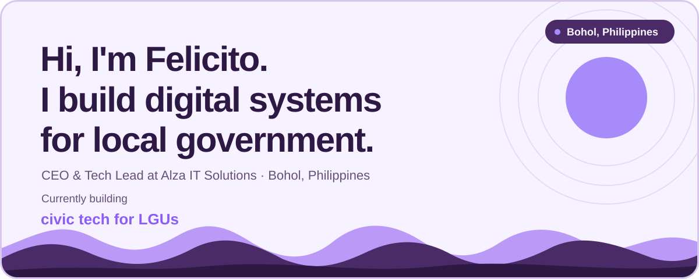
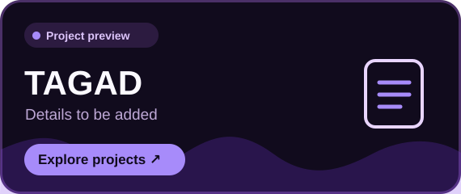
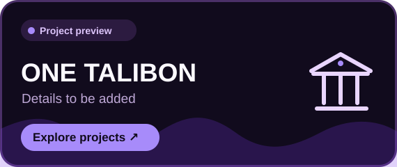
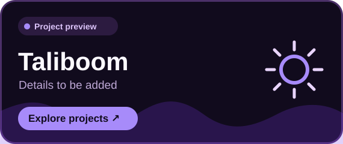
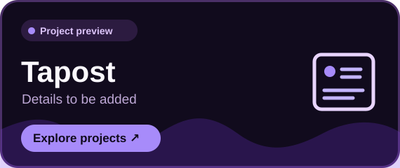
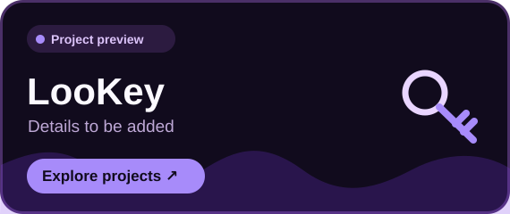

<!-- Profile README for catzdevw — black-violet Chocolate Hills design. Complete remaining placeholders via SETUP.md. -->

  <picture>
    <source media="(prefers-color-scheme: dark)" srcset="./assets/banner-dark.svg" />
    <source media="(prefers-color-scheme: light)" srcset="./assets/banner-light.svg" />
    
  </picture>

  <picture>
    <source media="(prefers-color-scheme: dark)" srcset="https://readme-typing-svg.demolab.com?font=DM+Sans&amp;weight=600&amp;size=20&amp;duration=3600&amp;pause=1100&amp;color=C4B5FD&amp;center=true&amp;vCenter=true&amp;width=760&amp;height=42&amp;lines=Digital+systems+for+LGUs%2C+businesses+and+schools;Civic+tech+and+government+digitization;Human-centered+tools+for+local+communities" />
    <source media="(prefers-color-scheme: light)" srcset="https://readme-typing-svg.demolab.com?font=DM+Sans&amp;weight=600&amp;size=20&amp;duration=3600&amp;pause=1100&amp;color=2D1944&amp;center=true&amp;vCenter=true&amp;width=760&amp;height=42&amp;lines=Digital+systems+for+LGUs%2C+businesses+and+schools;Civic+tech+and+government+digitization;Human-centered+tools+for+local+communities" />
    
  </picture>

I’m **Felicito**, CEO and Tech Lead at **Alza IT Solutions**, based in **Bohol, Philippines**. I build practical digital systems for local government units, businesses, and schools—especially work that makes services simpler, more accessible, and more dependable.

  
  
  

## Tech stack

Open a category to explore the tools. Each badge is a link to its official documentation or project website.

<table>
  <tr><td width="100%">
    

      
<strong>Languages · 8 technologies</strong>

      

        
        
        
        
        
        
        
        
      

    

  </td></tr>
  <tr><td width="100%">
    

      
<strong>Frontend · 5 technologies</strong>

      

        
        
        
        
        
      

    

  </td></tr>
  <tr><td width="100%">
    

      
<strong>Backend · 5 technologies</strong>

      

        
        
        
        
        
      

    

  </td></tr>
  <tr><td width="100%">
    

      
<strong>Mobile · 2 technologies</strong>

      

        
        
      

    

  </td></tr>
  <tr><td width="100%">
    

      
<strong>DevOps &amp; tools · 8 technologies</strong>

      

        
        
        
        
        
        
        
        
      

    

  </td></tr>
</table>

## Security practices

<table>
  <tr><td width="100%">
    

      
<strong>Secure design, scanning, and actionable findings</strong>

      
Security-focused practices and tools I keep in my development workflow and learning toolkit:

      

        
        
        
        
        
        
        
      

      
These badges describe focus areas and tools, not independent certifications or audit claims.

    

  </td></tr>
</table>

## Featured projects

A growing selection of my work. **These five project cards are placeholders** while their public repository URLs and descriptions are being prepared. They currently link to my public repositories list.

<table>
  <tr>
    <td width="50%" align="center"></td>
    <td width="50%" align="center"></td>
  </tr>
  <tr>
    <td width="50%" align="center"></td>
    <td width="50%" align="center"></td>
  </tr>
  <tr>
    <td width="50%" align="center"></td>
    <td width="50%" align="center">
More work taking shape.
</td>
  </tr>
</table>

## GitHub activity

Activity cards update through external services; public GitHub activity may take time to refresh.

<table>
  <tr>
    <td width="50%" align="center">
      <picture>
        <source media="(prefers-color-scheme: dark)" srcset="https://github-readme-stats.vercel.app/api?username=catzdevw&amp;show_icons=true&amp;hide_border=true&amp;include_all_commits=true&amp;rank_icon=github&amp;bg_color=110B1D&amp;title_color=F6F2FF&amp;text_color=D4C1E8&amp;icon_color=A78BFA&amp;ring_color=6D28D9" />
        <source media="(prefers-color-scheme: light)" srcset="https://github-readme-stats.vercel.app/api?username=catzdevw&amp;show_icons=true&amp;hide_border=true&amp;include_all_commits=true&amp;rank_icon=github&amp;bg_color=F6F2FF&amp;title_color=2D1944&amp;text_color=665079&amp;icon_color=6D28D9&amp;ring_color=A78BFA" />
        
      </picture>
    </td>
    <td width="50%" align="center">
      <picture>
        <source media="(prefers-color-scheme: dark)" srcset="https://streak-stats.demolab.com?user=catzdevw&amp;hide_border=true&amp;background=110B1D&amp;ring=A78BFA&amp;fire=A78BFA&amp;currStreakNum=F6F2FF&amp;sideNums=F6F2FF&amp;currStreakLabel=C4B5FD&amp;sideLabels=BEA8D6&amp;dates=A08CAB" />
        <source media="(prefers-color-scheme: light)" srcset="https://streak-stats.demolab.com?user=catzdevw&amp;hide_border=true&amp;background=F6F2FF&amp;ring=6D28D9&amp;fire=A78BFA&amp;currStreakNum=2D1944&amp;sideNums=2D1944&amp;currStreakLabel=2D1944&amp;sideLabels=8B5CF6&amp;dates=665079" />
        
      </picture>
    </td>
  </tr>
</table>

## Let's connect

Building something useful for your community, organization, or school? I’d love to hear about it. Contact destinations below are placeholders until my public links are added.

  
  
  

From Bohol, building technology for people and communities. 💜
