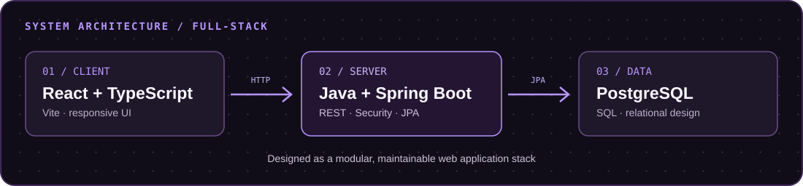

<!-- catzDev | GitHub profile README | GitHub-compatible HTML + Markdown, no JS -->

  
  
  
  
  

  

  
  
  

## How I build systems

  

<b>Explore the engineering approach ↗</b>

1. **Frontend:** components, typed state, validation, responsive layouts, and API integration.
2. **Backend:** controllers, services, repositories, DTOs, input validation, and REST APIs.
3. **Data:** relational schemas, queries, JPA/Hibernate mappings, and transactional persistence.
4. **Access control:** Spring Security, JWT-based authentication patterns, and role-based permissions.
5. **Delivery:** Git, code reviews, API tests, CI workflows, environment configuration, and deployment planning.

This is my preferred application architecture, not a claim that every project implements every tool.

## Technology stack

**Primary, hands-on stack**

  
  
  
  
  

<b>01 / Backend & API engineering</b> — Java ecosystem

 

<b>02 / Frontend & interface engineering</b> — Web technologies

 

       

<b>03 / Data & persistence</b> — Relational data

 

   

<b>04 / Engineering workflow</b> — Tools and delivery

 

      

<b>05 / Additional languages & interests</b> — Beyond the primary stack

 

  

## Engineering work

A selection of systems I've developed or worked on. **Some repositories are private or belong to collaborators**, so these are descriptive case studies rather than public source-code links.

<table>
<tr>
<td width="50%" valign="top">
<h3>01 / SakloloPH</h3>

<b>Disaster-relief coordination</b>

Resident assistance requests, status tracking, administrative workflows, and dashboard views.

<code>React</code> <code>TypeScript / JavaScript</code> <code>Java</code> <code>Spring Boot</code> <code>PostgreSQL</code>

Project work · Source not public

</td>
<td width="50%" valign="top">
<h3>02 / TAPOST</h3>

<b>NFC-enabled digital business profiles</b>

A product MVP for linking physical NFC cards to configurable digital profiles and business information.

<code>React</code> <code>TypeScript</code> <code>Java</code> <code>Spring Boot</code> <code>PostgreSQL</code>

In development · Source not public

</td>
</tr>
<tr>
<td width="50%" valign="top">
<h3>03 / Talibon Web</h3>

<b>Municipal website frontend</b>

Responsive public-facing pages, service information, interactive content, and UI refinement.

<code>React</code> <code>Frontend</code> <code>Responsive UI</code>

Collaborative project · Source not public

</td>
<td width="50%" valign="top">
<h3>04 / ONE TALIBON</h3>

<b>Municipal intra-office system</b>

Frontend workspace and dashboard refinement for an office system with permission-aware navigation.

<code>React</code> <code>TypeScript</code> <code>Laravel</code>

Collaborative project · Source not public

</td>
</tr>
</table>

## GitHub activity

  <picture>
    <source media="(prefers-color-scheme: dark)" srcset="https://github-readme-stats.vercel.app/api?username=catzdevw&amp;show_icons=true&amp;hide_border=true&amp;include_all_commits=true&amp;rank_icon=github&amp;bg_color=100D18&amp;title_color=C4A3FF&amp;text_color=D6CBE5&amp;icon_color=B896FF&amp;ring_color=8B5CF6" />
    <source media="(prefers-color-scheme: light)" srcset="https://github-readme-stats.vercel.app/api?username=catzdevw&amp;show_icons=true&amp;hide_border=true&amp;include_all_commits=true&amp;rank_icon=github&amp;bg_color=F9F7FF&amp;title_color=6D28D9&amp;text_color=352444&amp;icon_color=7C3AED&amp;ring_color=7C3AED" />
    
  </picture>
  <picture>
    <source media="(prefers-color-scheme: dark)" srcset="https://streak-stats.demolab.com?user=catzdevw&amp;hide_border=true&amp;background=100D18&amp;ring=A78BFA&amp;fire=A78BFA&amp;currStreakNum=F9F7FF&amp;sideNums=F9F7FF&amp;currStreakLabel=B896FF&amp;sideLabels=BAA9CC&amp;dates=9D8BAF" />
    <source media="(prefers-color-scheme: light)" srcset="https://streak-stats.demolab.com?user=catzdevw&amp;hide_border=true&amp;background=F9F7FF&amp;ring=6D28D9&amp;fire=8B5CF6&amp;currStreakNum=352444&amp;sideNums=352444&amp;currStreakLabel=6D28D9&amp;sideLabels=6D28D9&amp;dates=675675" />
    
  </picture>

  

Live cards are powered by third-party services and may be temporarily unavailable or cached. Private contributions may not be represented fully.

## Connect

Interested in collaborating on a practical web application, civic-tech project, or product idea?

  
  

catzDev • Code with intention. Build for impact. • Philippines 🇵🇭

