<div align="center">

<a href="https://github.com/catzdevw" title="Visit my GitHub profile">
  
</a>

<br/>

**I build full-stack web applications — from clean interfaces to secure APIs and reliable data.**

<a href="#-core-stack">Core stack</a> &nbsp;·&nbsp;
<a href="#-engineering-focus">Engineering focus</a> &nbsp;·&nbsp;
<a href="#-selected-work">Selected work</a> &nbsp;·&nbsp;
<a href="#-under-the-hood">Under the hood</a>

</div>

---

## ⚡ Core Stack

<p align="center">
  <a href="https://react.dev/" title="React"></a>&nbsp;
  <a href="https://www.typescriptlang.org/" title="TypeScript"></a>&nbsp;
  <a href="https://dev.java/" title="Java"></a>&nbsp;
  <a href="https://spring.io/projects/spring-boot" title="Spring Boot"></a>&nbsp;
  <a href="https://www.postgresql.org/" title="PostgreSQL"></a>
</p>

| Layer | Primary technologies | What I focus on |
| :--- | :--- | :--- |
| **Frontend** | **React · TypeScript** · Tailwind CSS · Bootstrap 5 | Component architecture, responsive UI, type safety |
| **Backend** | **Java · Spring Boot** · Spring Security | REST APIs, layered architecture, authentication & authorization |
| **Data** | **PostgreSQL** · Spring Data JPA · Hibernate | Relational modeling, SQL, persistence & transactions |
| **Delivery** | Git · Docker · Maven · GitHub Actions | Testing, version control, build & deployment workflows |

> **My default architecture:** React + TypeScript → Java + Spring Boot → PostgreSQL.

## 🎯 Engineering Focus

- **End-to-end systems:** connect frontend flows, backend business logic, and persistent data.
- **Backend fundamentals:** API design, validation, JWT-based security, RBAC, and maintainable service layers.
- **Reliable delivery:** debugging, database design, automated testing, and repeatable builds.

## 🚀 Selected Work

**[CATZ Harness CLI](https://github.com/catzdevw/CATZHarnessCLI)**  
An open-source CLI for reusable engineering workflows, local workspace management, and validation.

**SakloloPH** · *In development*  
A Philippine-focused assistance management platform built with **React, Spring Boot, and PostgreSQL**, featuring request workflows and role-based access. *(Private repository.)*

## 🧩 Under the Hood

<details>
<summary><strong>↳ Explore my full-stack architecture</strong></summary>
<br/>

```text
React + TypeScript
  └─ UI, forms, typed API integration
            │  REST / JSON
            ▼
Java + Spring Boot
  ├─ Controllers & DTOs
  ├─ Services & business logic
  └─ Spring Security
            │  JPA / Hibernate
            ▼
        PostgreSQL
```

I prefer clear separation of concerns: approachable UIs, explicit API contracts, focused service logic, and well-designed data models.

</details>

<details>
<summary><strong>↳ Secondary stack & other tools</strong></summary>
<br/>

**Backend alternatives:** Node.js, NestJS, Prisma (for TypeScript-based services).  
**Development:** IntelliJ IDEA, VS Code, DBeaver, Postman, Linux.  
**Testing & cloud:** JUnit, Mockito, Docker Compose, Vercel, Google Cloud Run.

</details>

---

<div align="center">

<a href="https://github.com/catzdevw?tab=repositories"></a>
<a href="https://github.com/catzdevw/CATZHarnessCLI"></a>

<sub>Build thoughtfully. Test thoroughly. Ship confidently.</sub>

</div>
